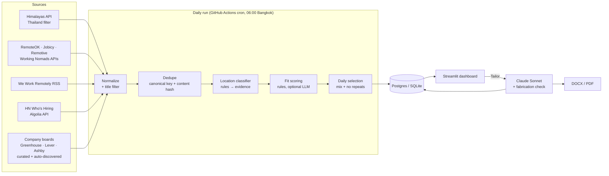

# Job Scanner

**A daily pipeline that finds remote data-analyst and junior tech jobs that will actually hire someone living in Thailand, then tailors a resume and cover letter for each one on demand.**

Most "remote" jobs are really remote-within-one-country. Finding the ones open to a candidate in UTC+7 means reading the location fine print on dozens of postings a day. This project automates that: it pulls jobs from 8 sources, merges duplicates, classifies each posting's location eligibility with evidence, scores fit against a structured profile, and serves a short daily list in a dashboard.

Built by Tyler Nam as a personal tool and a working example of an end-to-end data product: ingestion, modeling, classification with a measured error rate, scheduling, and a UI.

---

## What it does

- **Ingests** ~14,000 raw postings per run from job-board APIs and ~180 company career boards on Greenhouse, Lever and Ashby: 72 hand-curated, plus boards it **discovers automatically** from links in other postings and from an open directory of remote-friendly companies.
- **Deduplicates** cross-posts and reposts into one record per real job, keeping every board's link and every regional variant.
- **Classifies Thailand eligibility** as Confirmed / Likely / Unknown / Excluded, always with the quote that justifies it.
- **Scores fit** (0–100) against a structured candidate profile: rules first, with an optional Claude Haiku pass.
- **Picks a daily list** (up to 10, analyst roles first) and never shows the same job twice.
- **Tailors on demand.** A button generates a resume and cover letter with Claude Sonnet, behind a deterministic **fabrication check** that blocks invented numbers, skills or tools.
- **Tracks** saved, applied and skipped jobs (with reasons) in a Streamlit dashboard, with CSV export.

## Architecture



**Stack:** Python 3.12+, httpx, SQLAlchemy 2 (Postgres in production, SQLite locally), Pydantic, Anthropic SDK (structured outputs), Streamlit, python-docx + ReportLab, pytest, GitHub Actions.

## Design decisions

| Decision | Why |
|---|---|
| **Rules first, LLM second** | Regex rules are free, deterministic and testable. The LLM handles only what rules leave ambiguous, under a hard monthly budget cap, and the system degrades to rules-only without credentials. |
| **One `Job`, many `Posting`s** | The same job appears on 2–3 boards and is often posted once per region. Postings merge into one job on a normalized `company\|title` key or an identical description hash, and every region's location text is kept so an APAC variant isn't lost behind a US one. |
| **Location field beats description; specific beats broad** | Boards auto-apply tags like "Anywhere in the World" that the description then contradicts ("must be based in Latin America"). Explicit APAC/Thailand signals are trusted outright; broad "worldwide" tags can be overridden by the text. |
| **Company boards need an explicit remote signal** | Greenhouse/Lever/Ashby list office jobs too. A Bangkok *office* role is not a remote role. |
| **Never repeat, never pad** | Shown jobs are recorded by ID *and* canonical key for 60 days. If fewer than 10 jobs clear the quality bar, the list is shorter. |
| **Tailoring can reword, never invent** | Each bullet must cite the master bullet it rewrites. Names, titles and dates come from the profile, not the model. A program, not the model, checks every number, skill and tool, retries once with the violations listed, and otherwise blocks export. |

## Results (measured)

**Location classifier.** I evaluated it against 45 postings hand-labeled *blind*: a separate labeler saw only the posting text, never the classifier's output.

| Iteration | Precision (Confirmed + Likely) | What changed |
|---|---|---|
| v1 | 15/22 = **68%** | Trusted broad "worldwide" tags at face value |
| v2 | 10/10 = 100%, but 5 good jobs lost | Description restrictions override broad tags; a regex grouping bug over-matched bare region names |
| v3 (current) | 15/16 = **94%**, recall 15/15, exact tier 44/45 | Fixed the grouping, "non-US only" handling, and "anywhere in ⟨region⟩" phrasing |

The labeled set lives in `tests/fixtures/`, and `test_precision_on_hand_labeled_sample` fails if precision drops below 90%.

**Volume** (one full run, Oct 2026):

| Stage | Count |
|---|---|
| Raw postings fetched | 8,248 (3,104 from aggregators + 5,144 from company boards) |
| Title in a target role family | 467 |
| Fresh and stored after dedupe | 266 |
| Pass every filter (Thailand-eligible, right seniority) | 73 |
| New qualifying jobs per day | ≈ 4–7 (7 posted in the last 24 h, 30 in the last 7 days) |

**Board discovery** (no ATS offers cross-company search, so the scanner builds its own list): one run added 106 boards (68 from the [remoteintech.company](https://remoteintech.company) directory's worldwide/APAC companies, 38 from links in HN and RemoteOK postings) and doubled company-board volume to 10,651 postings. But only **1 of 172** new jobs passed the location filter. Large company boards rarely post roles open to Thailand, so the filter, not the volume, is what matters. Discovery stays on because it's cheap, but the job aggregators that filter by country do most of the work.

Tuning the sources raised the qualifying pool from **26 → 73**. The changes: paging Himalayas' Thailand-filtered search to the end with rate-limit backoff, querying the boards' tag and category feeds, and widening the title patterns based on which titles were being dropped.

**Tests:** 86 (pytest), covering dedupe, the location rules and the labeled-precision gate, a 7-day no-repeat simulation, scoring with a fake LLM client (budget cap, refusal fallback), the fabrication check, DOCX/PDF rendering, and the dashboard via Streamlit's `AppTest`.

## Run it locally

```bash
python3 -m venv .venv && .venv/bin/pip install -e '.[dev]'
.venv/bin/python -m scanner.run_daily        # fetch → dedupe → classify → score → pick today's list (~12 min)
.venv/bin/streamlit run dashboard/app.py     # dashboard at http://localhost:8501
.venv/bin/pytest -q                          # tests
```

Without any setup it uses a **fictional example profile** (`profile/example/`) and local SQLite (`data/jobs.db`).

Optional environment variables:

| Variable | Effect |
|---|---|
| `DATABASE_URL` | Postgres URL (e.g. Neon/Supabase). Default: local SQLite. |
| `ANTHROPIC_API_KEY` | Turns on LLM scoring (Haiku) and the Tailor button (Sonnet). Without it, scoring is rules-only. |
| `PROFILE_DIR` | Folder holding `master_profile.json` + `gap_story.yaml`. Default: `profile/` if present, else `profile/example/`. |

### Use your own profile

Copy `profile/example/master_profile.json` and `gap_story.yaml` to `profile/` and edit them. Both are git-ignored, so your contact details and history never get committed. Target roles, location rules, scoring weights and the company list are in `config/*.yaml`.

### Deploy

- **Daily scan:** `.github/workflows/daily.yml` runs at 23:00 UTC (06:00 Bangkok). Add repository secrets `DATABASE_URL`, optionally `ANTHROPIC_API_KEY`, and `MASTER_PROFILE_JSON` / `GAP_STORY_YAML` (the contents of your profile files). The workflow writes the profile files at runtime.
- **Dashboard:** deploy `dashboard/app.py` on Streamlit Community Cloud as a private app, with the same secrets.

## Repository layout

```
scanner/
  sources/        one adapter per job source + shared throttled HTTP helper
  normalize.py    plain text, canonical keys, content hash, role-family rules
  dedupe.py       merge cross-posts / reposts / regional variants
  discover.py     find more Greenhouse / Lever / Ashby boards automatically
  location.py     Thailand-eligibility tiers with evidence
  scoring.py      rule score + optional LLM score, budget cap
  select.py       daily list: mix, min score, no repeats
  tailor.py       resume + cover letter generation and fabrication check
  render.py       DOCX / PDF output
  run_daily.py    entry point
dashboard/app.py  Streamlit UI (Today · Tracker · Settings)
config/           role patterns, location rules, scoring weights, curated companies
profile/example/  fictional sample profile
tests/            pytest suite + blind-labeled location fixtures
PRD.md            product requirements, decisions and milestone log
```

## Status and roadmap

- ✅ M0–M4: ingestion, dedupe, classification, scoring, daily list, dashboard, on-demand tailoring.
- ⚠️ **The LLM paths have only been tested against a fake client**, not yet against the live Claude API. Their output quality, latency and cost are unmeasured.
- ⏭️ M5: learn from skip reasons and applied/saved signals. M6: one-click-approve applications for Greenhouse, Lever and Ashby forms (never bypassing CAPTCHAs, always pausing on unknown screening questions).

## Responsible use

Only public job APIs and RSS feeds are used. LinkedIn, Indeed and Glassdoor are deliberately excluded because their terms prohibit scraping. Requests identify themselves and back off on rate limits. Test fixtures keep only the location-relevant sentences of public postings.
